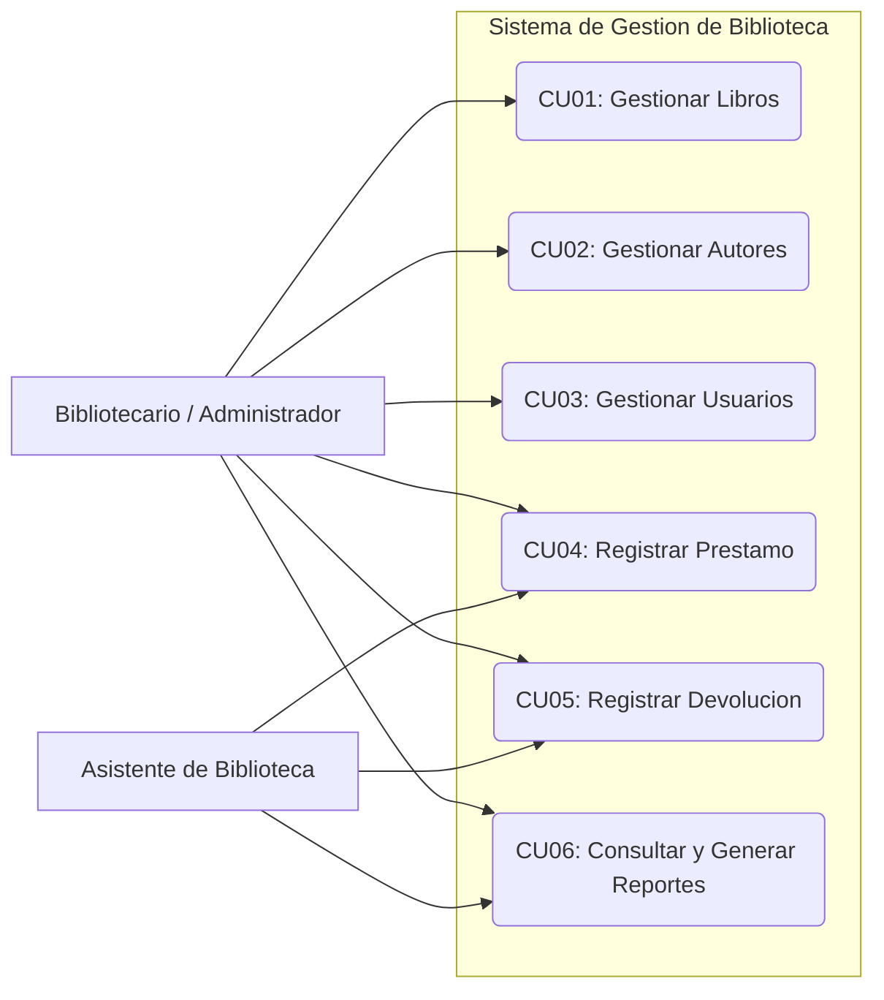
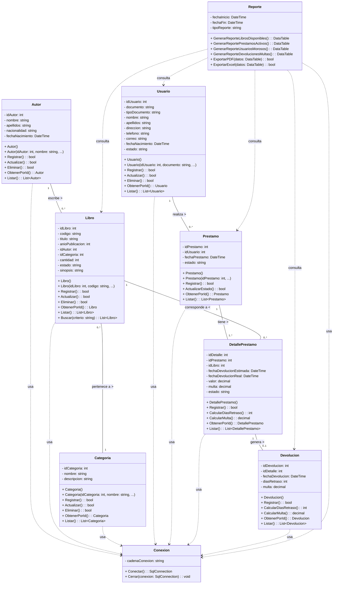
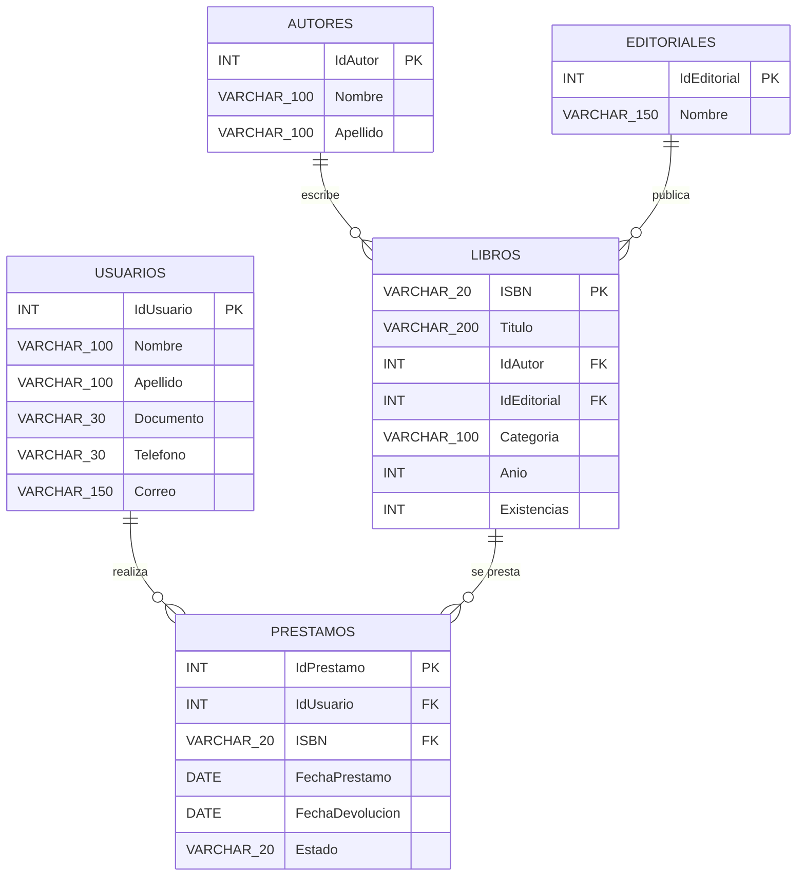
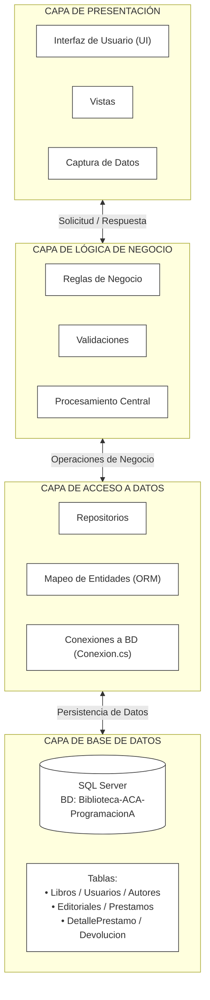
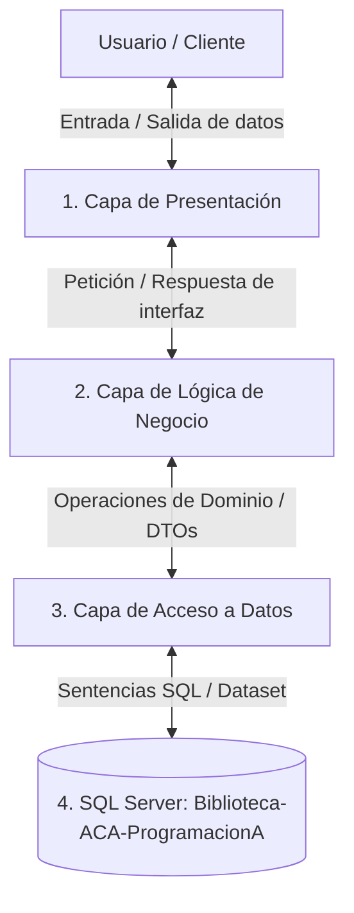

# ACA - Programación Avanzada

# Sistema de Gestión de Biblioteca

---

## PORTADA

**CORPORACION UNFICADA NACIONAL DE LA EDUCACION SUPERIOR**

**INGENIERIA DE SISTEMAS / PROGRAMACION AVANZADA**

### ACA - Programación Avanzada

### Sistema de Gestión de Biblioteca

**Presentado por:**

Laura Ximena Bejarano Acosta y Claudith Beltran Landero

**Docente:**
Veronica Castro Munar

**Fecha:**\
Bogóta, 10, noviembre 2026

---------------------------------------------------------------------------

# CONTRAPORTADA

**Sistema de Gestión de Biblioteca**

Proyecto desarrollado como evidencia del curso de **Programación
Avanzada**, aplicando Programación Orientada a Objetos, base de datos
relacional, arquitectura por capas, operaciones CRUD, validaciones,
manejo de excepciones y conexión con SQL Server.

**Estudiante(s):** Laura Ximena Bejarano Acosta y Claudith Beltran Landero\
**Programa:** Ingenieria de sistemas\
**Grupo:** 54463\
**Docente:** Veronica Castro Munar\
**Institución:** Corporacion Unificada Nacional de la Edcucacion Superior - CUN\
**Año:** 2026

------------------------------------------------------------------------

# TABLA DE CONTENIDO

1.  Introducción
2.  Objetivos
    -   2.1 Objetivo general
    -   2.2 Objetivos específicos
3.  Planteamiento del problema
4.  Análisis de requerimientos
5.  Casos de uso
6.  Diagrama de clases
7.  Modelo entidad-relación
8.  Diccionario de datos
9.  Arquitectura del sistema
10. Explicación de los módulos desarrollados
11. Capturas de pantalla del sistema
12. Pruebas de funcionamiento
13. Conclusiones
14. Recomendaciones
15. Referencias bibliográficas

------------------------------------------------------------------------

# 1. INTRODUCCIÓN

La construcción de aplicaciones de escritorio orientadas a la administración de datos requiere una arquitectura sólida que garantice la estabilidad del sistema y la fluidez del usuario. En el presente documento, este trabajo aborda la implementación técnica de un Sistema de Gestión de Biblioteca desarrollado en C# con Windows Forms y almacenamiento en SQL Server, aplicando principios de Programación Orientada a Objetos y una arquitectura por capas.A lo largo del desarrollo se implementan componentes clave como el control transaccional de préstamos y devoluciones, el filtrado y actualización dinámica del catálogo bibliográfico y la creación de consultas complejas para la emisión de reportes.

La aplicación permite gestionar **libros, autores, editoriales, préstamos, reportes.** El resultado es un producto software funcional, diseñado bajo estándares de programación modular que facilitan el mantenimiento y escalabilidad del sistema.

------------------------------------------------------------------------

# 2. OBJETIVOS

## 2.1 Objetivo general

Desarrollar e implementar un Sistema de Gestión de Biblioteca mediante una aplicación de escritorio en **C#, Windows Forms y SQL Server**, bajo una arquitectura modular que garantice la estabilidad del sistema, la consistencia de los datos y la automatización eficiente de los procesos de inventario, préstamos y generación de reportes., utilizando Programación Orientada a
Objetos, una base de datos relacional y una arquitectura por capas.

## 2.2 Objetivos específicos

-   Diseñar e implementar la base de datos relacional en SQL Server, definiendo las entidades **libros, autores, editoriales, préstamos, reportes.**, relaciones y restricciones de integridad necesarias para asegurar el almacenamiento consistente de la información bibliográfica.
-   Desarrollar la interfaz gráfica de usuario en Windows Forms, construyendo formularios intuitivos y modulares que faciliten la ejecución de las operaciones CRUD (crear, leer, actualizar y eliminar) para el catálogo y la gestión de usuarios.
-   Programar la lógica de negocio y el control transaccional en C# para la gestión en tiempo real de préstamos y devoluciones, asegurando el seguimiento preciso del estado del inventario y evitando inconsistencias en las fechas y disponibilidad.
-   Construir un módulo de consultas complejas y reportes que permita filtrar el catálogo bibliográfico dinámicamente y emitir informes operativos sobre el estado de los préstamos, optimizando el tiempo de respuesta en la toma de decisiones administrativas.

------------------------------------------------------------------------

# 3. PLANTEAMIENTO DEL PROBLEMA

## 3.1 Descripción del problema

En la actualidad, la institución educativa enfrenta importantes limitaciones operativas en la administración de su biblioteca debido a la ausencia de un sistema informático centralizado y automatizado. Procesos clave como el registro de material bibliográfico (libros, autores y editoriales), el control de usuarios y el seguimiento de préstamos y devoluciones se realizan mediante métodos manuales o herramientas ofimáticas aisladas. Esta dinámica genera reprocesos en la gestión diaria, incrementa el riesgo de pérdida o duplicidad de información y dificulta conocer en tiempo real la disponibilidad real del catálogo.

Asimismo, la falta de una arquitectura de datos estructurada impide llevar un control estricto sobre las fechas de vencimiento de los préstamos, el estado físico de los libros y el historial de uso por parte de los usuarios. Esta desorganización afecta la toma de decisiones administrativas, ya que la consolidación de datos para la emisión de reportes e informes de gestión requiere un esfuerzo considerable y carece de la precisión necesaria.

Ante esta situación, se hace indispensable el desarrollo e implementación de una aplicación de escritorio robusta sobre C#, Windows Forms y SQL Server. Esta solución tecnológica permitirá centralizar la información bibliográfica, automatizar el ciclo transaccional de préstamos y devoluciones y garantizar la integridad y consistencia de los datos almacenados, transformando la administración de la biblioteca en un proceso eficiente, seguro y escalable.

## 3.2 Justificación

Desde la perspectiva institucional, es indispensable migrar de un esquema de gestión manual o fragmentado a un entorno digital centralizado. La implementación del sistema resolverá de forma directa los problemas de inconsistencia y pérdida de datos, al tiempo que optimizará los tiempos de atención y respuesta en la biblioteca.

## 3.3 Alcance

Entre los beneficios operativos principales destacan:

-   Automatización del ciclo transaccional: Garantiza el seguimiento preciso de los préstamos y devoluciones en tiempo real, evitando discrepancias en el inventario y facilitando el control de fechas de entrega.
-   Optimización de la toma de decisiones: La capacidad de generar reportes detallados y consolidados permite al personal administrativo evaluar el estado del catálogo, identificar los materiales más demandados y planificar adquisiciones futuras de forma informada.
-   Eficiencia en la atención al usuario: Agiliza la búsqueda y consulta de libros por autor, editorial o disponibilidad, mejorando significativamente la experiencia de estudiantes y docentes.
- Desarrollo robusto con C# y .NET Framework: C# es un lenguaje de programación orientado a objetos, fuertemente tipado y de alto rendimiento. Proporciona una estructura clara mediante la separación en capas (Presentación, Lógica de Negocio y Acceso a Datos), lo que facilita el mantenimiento, la modularidad y la escalabilidad a futuro del código.
- Interfaz ágil y nativa con Windows Forms: Windows Forms ofrece un entorno maduro para la construcción de interfaces gráficas de usuario (GUI) en plataformas Windows. Permite diseñar formularios intuitivos, livianos y de rápida curva de aprendizaje para los operadores del sistema, reduciendo los tiempos de capacitación del personal.

### Fuera del alcance

-   Delimitación y Alcance del Proyecto
-   Plataformas y Accesibilidad Web / Móvil
- Gestión Económica y Sanciones

------------------------------------------------------------------------

# 4. ANÁLISIS DE REQUERIMIENTOS

## 4.1 Descripción general

El Sistema de Gestión de Biblioteca permitirá administrar de manera centralizada la información relacionada con libros, autores, editoriales y usuarios, optimizando el catálogo bibliográfico y garantizando la integridad de los datos. Asimismo, la aplicación automatizará los procesos operativos de registro de préstamos, control de devoluciones, consulta dinámica de inventario y emisión de reportes gerenciales, proporcionando al personal administrativo una herramienta eficiente en entorno de escritorio para la toma de decisiones y el seguimiento del ciclo de vida del material bibliográfico.

## 4.2 Actores del sistema

  -----------------------------------------------------------------------
   -----------------------------------------------------------------------
 

  | Actor | Descripción |
| :--- | :--- |
| **Bibliotecario / Administrador** | Usuario principal con acceso total. Gestiona el catálogo de libros, autores y editoriales. |
| **Asistente de Biblioteca** | Usuario operativo que realiza búsquedas, préstamos y devoluciones en mostrador. |
  -----------------------------------------------------------------------

## 4.3 Requerimientos funcionales

| Código | Requerimiento | Descripción |
| :--- | :--- | :--- |
| **RF01** | **Gestionar libros** | Registrar, consultar, actualizar, eliminar y buscar libros en el catálogo bibliográfico. |
| **RF02** | **Gestionar autores** | Registrar, consultar, actualizar, eliminar y asociar autores al material bibliográfico. |
| **RF03** | **Gestionar categorías** | Registrar, consultar, actualizar y eliminar las categorías o géneros de los libros. |
| **RF04** | **Gestionar usuarios** | Registrar, consultar, actualizar y eliminar la información de los usuarios (estudiantes/docentes). |
| **RF05** | **Registrar préstamos** | Registrar las salidas de libros y actualizar automáticamente la disponibilidad del inventario. |
| **RF06** | **Registrar devoluciones** | Registrar la recepción de libros prestados y calcular días de retraso o penalización cuando aplique. |
| **RF07** | **Realizar consultas** | Consultar libros disponibles, préstamos activos, historial de transacciones y usuarios con entregas pendientes. |
| **RF08** | **Generar reportes** | Emitir e imprimir informes detallados sobre el estado del inventario, préstamos por periodo y morosidad de usuarios. |
  -----------------------------------------------------------------------

## 4.4 Requerimientos no funcionales

| Código | Requerimiento | Descripción |
| :--- | :--- | :--- |
| **RNF01** | **Usabilidad** | El sistema debe contar con una interfaz estándar en Windows Forms que permita al operador completar un registro o consulta en no más de 3 clics principales. |
| **RNF02** | **Seguridad y Validación** | El sistema debe restringir el ingreso de caracteres inválidos o dañinos en los formularios de entrada mediante comprobación de tipos de datos antes del envío a la base de datos. |
| **RNF03** | **Mantenibilidad** | El proyecto debe ser desarrollado bajo estándares de código limpio en C#, manteniendo una tasa de acoplamiento baja que permita modificar componentes sin afectar el resto del sistema. |
| **RNF04** | **Arquitectura del sistema** | La aplicación debe estar estructurada obligatoriamente en tres capas lógicas (Presentación, Lógica de Negocio y Acceso a Datos) para garantizar el desacoplamiento de componentes. |
| **RNF05** | **Tolerancia a fallos** | El sistema debe capturar cualquier excepción no controlada en tiempo de ejecución sin provocar el cierre inesperado del programa, registrando el evento y notificando al usuario. |
| **RNF06** | **Integridad y Persistencia** | La base de datos en SQL Server debe cumplir las propiedades ACID (Atomicidad, Consistencia, Aislamiento y Durabilidad) en la ejecución de transacciones concurrentes. |
| **RNF07** | **Seguridad en consultas** | Toda comunicación entre la aplicación C# y SQL Server debe emplear exclusivamente consultas parametrizadas para neutralizar riesgos de inyección SQL. |
| **RNF08** | **Tiempo de respuesta** | Las búsquedas del catálogo y la carga de datos en pantallas principales deben ejecutarse en un tiempo máximo de 2 segundos bajo condiciones normales de red local. |
-----------------------------------------------------------------------

## 4.5 Reglas de negocio

### RN01 -- Código único del libro

No se permitirá registrar dos libros con el mismo código.

### RN02 -- Datos obligatorios

No se permitirá almacenar registros con campos obligatorios vacíos.

### RN03 -- Usuario existente

No se podrá registrar un préstamo para un usuario inexistente.

### RN04 -- Libro existente

No se podrá registrar un préstamo para un libro inexistente.

### RN05 -- Disponibilidad

No se podrá prestar un libro cuando no existan ejemplares disponibles.

### RN06 -- Actualización de disponibilidad

Al registrar un préstamo, la disponibilidad del libro deberá
actualizarse.

### RN07 -- Devolución

Al registrar una devolución, la disponibilidad deberá actualizarse
nuevamente.

### RN08 -- Multa

La multa se calculará únicamente cuando exista retraso en la devolución.

### RN09 -- Límite máximo de préstamos
No se permitirá realizar un nuevo préstamo a un usuario que ya cuente con 3 o más libros en estado activo/prestado.

### RN10 -- Restricción por morosidad
No se procesarán nuevos préstamos a usuarios que mantengan entregas pendientes con días de retraso o multas no saldadas.

------------------------------------------------------------------------
# 5. CASOS DE USO

## 5.1 Descripción

El diagrama y la especificación de casos de uso describen las interacciones entre los actores del sistema (Bibliotecario / Administrador y Asistente de Biblioteca) y los diferentes módulos funcionales de la aplicación de escritorio. Estas interacciones abarcan la administración del catálogo (libros, autores, categorías), la gestión de usuarios registrados y el ciclo transaccional completo de préstamos, devoluciones y generación de reportes.

## 5.2 Diagrama de casos de uso

## 5.3 Descripción de casos de uso

### CU01 -- Gestionar libros

**Actor principal:** Bibliotecario / Administrador

**Descripción:** Permite registrar, consultar, actualizar, eliminar (desactivar) y buscar libros dentro del catálogo bibliográfico de la biblioteca.

**Precondiciones:**
- El usuario debe tener acceso al sistema mediante credenciales válidas y rol asignado.
- Deben existir categorías, autores y editoriales previos cargados en la base de datos para asociar al libro.

**Flujo principal:**
1. El actor ingresa al módulo de gestión de libros desde el menú principal.
2. El sistema despliega la lista actualizada de libros registrados desde la base de datos SQL Server.
3. El actor selecciona la operación que desea realizar (crear, modificar, consultar o desactivar).
4. El actor ingresa o edita la información del libro (Título, ISBN, Autor, Categoría, Editorial, Año de publicación y Stock).
5. El sistema procesa la solicitud mediante la capa de negocio (BLL) y aplica las validaciones requeridas.
6. El sistema guarda la transacción en SQL Server y muestra un mensaje en pantalla confirmando el resultado exitoso.

**Flujos alternativos:**
- **F-Alt 1 (Campos incompletos):** Si el actor deja campos requeridos vacíos (como ISBN o Título), el sistema cancela la operación y notifica al usuario los datos faltantes.
- **F-Alt 2 (ISBN duplicado):** Si se intenta registrar un libro cuyo ISBN ya existe en SQL Server, el sistema cancela el guardado e informa que el código no puede repetirse.
- **F-Alt 3 (Eliminación no permitida):** Si el libro posee préstamos vinculados activos o historial en el sistema, la aplicación bloquea el borrado físico y realiza una inactivación lógica.

**Postcondiciones:**
- El catálogo de libros queda guardado y actualizado en la base de datos SQL Server, disponible inmediatamente para préstamos y búsquedas.

### CU02 -- Registrar préstamo

**Actor principal:** Bibliotecario / Administrador / Asistente de biblioteca

**Descripción:** Permite registrar la salida temporal de uno o varios ejemplares bibliográficos asignados a un usuario registrado en el sistema.

**Precondiciones:**
- El usuario debe estar previamente registrado en la base de datos y en estado "Activo" (sin sanciones pendientes).
- El libro solicitado debe existir en el catálogo y contar con al menos una unidad disponible en el stock.

**Flujo principal:**
1. El actor ingresa al módulo de registro de préstamos.
2. El actor busca y selecciona al usuario mediante su documento de identidad o código.
3. El actor busca y selecciona el libro a prestar utilizando su título o código ISBN.
4. El sistema verifica automáticamente el stock disponible y valida que el usuario no tenga mora ni exceda el límite de préstamos permitidos.
5. El actor confirma la transacción y el sistema calcula la fecha límite de devolución.
6. El sistema descuenta el stock disponible del libro, guarda el registro del préstamo en la base de datos de SQL Server y muestra un mensaje de confirmación en pantalla.

**Flujos alternativos:**
- **F-Alt 1 (Usuario inexistente o inactivo):** Si el usuario no se encuentra registrado o tiene el estado "Inactivo/Sancionado", el sistema deniega la operación y muestra una alerta notificando el impedimento.
- **F-Alt 2 (Libro inexistente o sin stock):** Si el código del libro no existe o su stock actual es igual a cero, el sistema bloquea el registro e informa la indisponibilidad del ejemplar.
- **F-Alt 3 (Límite de préstamos alcanzado):** Si el usuario ya posee el número máximo de libros prestados simultáneamente, el sistema cancela la operación indicando que debe devolver ejemplares antes de solicitar uno nuevo.

**Postcondiciones:**
- El préstamo queda registrado formalmente en la base de datos de SQL Server con estado "Activo".
- El stock disponible del libro prestado se disminuye automáticamente.

---

### CU03 -- Registrar devolución

**Actor principal:** Bibliotecario / Administrador / Asistente de biblioteca

**Descripción:** Permite procesar el retorno de los libros prestados, verificando la fecha de entrega para aplicar sanciones o multas en caso de mora.

**Precondiciones:**
- Debe existir un registro de préstamo activo vinculado al usuario y al libro que se va a devolver.

**Flujo principal:**
1. El actor ingresa al módulo de devoluciones e ingresa el documento del usuario o el código del préstamo.
2. El sistema busca y despliega la lista de préstamos activos correspondientes.
3. El actor selecciona el préstamo o ejemplar que el usuario está entregando.
4. El sistema compara la fecha actual con la fecha límite de devolución y calcula automáticamente si existen días de retraso.
5. El sistema calcula el monto de la multa por mora en caso de aplicar, según la tarifa establecida.
6. El actor confirma la recepción del ejemplar.
7. El sistema incrementa el stock disponible del libro, actualiza el estado del préstamo a "Devuelto" en SQL Server y muestra el resumen de la entrega (con o sin penalización).

**Flujos alternativos:**
- **F-Alt 1 (Préstamo no encontrado):** Si el código ingresado no coincide con ningún préstamo en estado "Activo", el sistema muestra un aviso de error indicando que la devolución no puede procesarse.
- **F-Alt 2 (Devolución con retraso / Generación de multa):** Si la fecha actual supera la fecha pactada, el sistema genera de forma implícita un registro de multa pendiente para el usuario y bloquea sus nuevos préstamos hasta que se gestione el pago.
- **F-Alt 3 (Libro dañado o extraviado):** Si el ejemplar presenta deterioros severos al momento de la entrega, el actor puede marcarlo como "Dañado", lo cual excluye la unidad del stock activo y genera un cargo de reposición.

**Postcondiciones:**
- El estado del préstamo cambia a "Devuelto" (o "Devuelto con mora") en la base de datos de SQL Server.
- El stock disponible del libro incrementa en 1 unidad en el inventario.

# 6. DIAGRAMA DE CLASES

## 6.1 Descripción

El diagrama de clases representa la estructura estática del sistema de gestión de biblioteca (LMS), definiendo los modelos de dominio, sus atributos, métodos principales y las relaciones de asociación, agregación, composición y herencia entre las entidades. Esta estructura desvincula los datos procesados en la capa de interfaz gráfica (UI) de las capas de lógica de negocio (BLL) y acceso a datos (DAL).

## 6.2 Diagrama de clases

## 6.3 Principales clases

| Clase | Responsabilidad |
| :--- | :--- |
| **Libros** | Representar y gestionar la información del catálogo bibliográfico y sus existencias (ISBN, Título, Categoría, Año, Existencias). |
| **Autores** | Representar y gestionar la información de los autores registrados en la base de datos (IdAutor, Nombre, Apellido). |
| **Editoriales** | Representar y gestionar las casas editoriales publicadoras (IdEditorial, Nombre). |
| **Usuarios** | Representar los datos personales de los lectores habilitados para realizar préstamos (IdUsuario, Nombre, Apellido, Documento, Teléfono, Correo). |
| **Prestamos** | Gestionar las transacciones de préstamo, fechas de salida/devolución y control de estado de la entrega (IdPrestamo, IdUsuario, ISBN, FechaPrestamo, FechaDevolucion, Estado). |

## 6.4 Aplicación de POO

En el desarrollo del sistema en C# se aplicaron los siguientes principios y conceptos de la Programación Orientada a Objetos:

- **Clases:** Se crearon plantillas o modelos conceptuales en la capa de entidades (`Entities`) para estructurar los datos del sistema (`Usuarios`, `Prestamos`, `Libros`, `Autores`, `Editoriales`).
- **Objetos:** Se instancian en memoria desde los formularios WinForms para manipular la información procesada por la lógica de negocio antes de ser enviada a SQL Server.
- **Constructores:** Se implementaron constructores por defecto y parametrizados para instanciar objetos asignando valores iniciales directamente desde los registros cargados de la base de datos.
- **Métodos:** Se definieron métodos de acción y validación dentro de las clases de negocio (ej. `ValidarExistencias()`, `RegistrarPrestamo()`, `CalcularFechaDevolucion()`).
- **Propiedades:** Se utilizaron propiedades auto-implementadas con accesores `get` y `set` para exponer los valores de cada atributo de forma estructurada.
- **Encapsulamiento:** Se protegió el acceso directo a las variables internas definiendo modificadores de acceso (`private` / `public`), garantizando que la modificación de datos pase obligatoriamente por la capa de negocio (BLL).
- **Colecciones:** Uso de listas genéricas (`List<Libros>`, `List<Prestamos>`) para manipular conjuntos de datos en memoria y alimentar las listas desplegables y controles `DataGridView` de la interfaz.
- **Herencia:** No aplica directamente en las entidades base del modelo actual, ya que cada entidad representa una tabla independiente de la base de datos relacional.
- **Polimorfismo:** Se aplicó mediante la implementación de interfaces estándar de persistencia (ej. `ICrud<T>`) para reutilizar firmas de métodos como `Insertar()`, `Actualizar()` y `Eliminar()` según el tipo de objeto.
- **Sobrecarga:** Implementada en métodos de búsqueda (ej. `BuscarLibro(string isbn)` y `BuscarLibro(string titulo)`), permitiendo ejecutar operaciones de consulta bajo diferentes parámetros.

# 7. MODELO ENTIDAD-RELACIÓN

## 7.1 Descripción

El Modelo Entidad-Relación (MER) define la estructura lógica de la base de datos relacional implementada en Microsoft SQL Server para el Sistema de Gestión de Biblioteca (LMS). El modelo está optimizado en Tercera Forma Normal (3FN) para garantizar la integridad referencial, evitar la duplicidad de datos y dar soporte a las operaciones transaccionales consumidas desde la capa de acceso a datos (DAL).

## 7.2 Diagrama entidad-relación

## 7.3 Relaciones principales

A continuación se describen las asociaciones y cardinalidades que conectan las entidades del dominio dentro del sistema:

- **Autor – Libro (1 : 0..*):** Un autor puede haber escrito uno o más libros, mientras que cada ejemplar en el catálogo pertenece a un único autor.
- **Categoría – Libro (1 : 0..*):** Una categoría o editorial abarca múltiples libros, pero cada libro está clasificado bajo una sola categoría.
- **Usuario – Préstamo (1 : 0..*):** Un usuario habilitado puede efectuar múltiples préstamos, estando cada préstamo vinculado a un solo lector.
- **Préstamo – DetallePrestamo (1 : 1..*):** Una transacción de préstamo se compone de uno o varios detalles de ejemplares solicitados.
- **Libro – DetallePrestamo (1 : 0..*):** Un libro puede figurar en diferentes detalles de préstamos a lo largo del tiempo, pero cada detalle hace referencia a un solo libro.
- **DetallePrestamo – Devolución (1 : 0..1):** Cada detalle de préstamo registrado puede derivar en un único registro de devolución al concretar la entrega física del libro.
- **Entidades – Conexión (Dependencia):** Las clases de negocio utilizan la clase `Conexion` para administrar la apertura, ejecución de comandos y cierre de sesiones con SQL Server.

# 8. DICCIONARIO DE DATOS

## 8.1 Convenciones

| Abreviatura | Significado |
| :--- | :--- |
| **PK** | Clave primaria |
| **FK** | Clave foránea |
| **UQ** | Campo con valor único |
| **NULL** | Campo que permite valores nulos (opcional) |
| **NOT NULL** | Campo obligatorio (no permite valores nulos) |

## 8.2 Tabla: AUTORES

| Campo | Tipo de dato | Clave | Nulo | Descripción |
| :--- | :--- | :--- | :--- | :--- |
| **IdAutor** | INT | PK | NOT NULL | Identificador único del autor (Identity). |
| **Nombre** | VARCHAR(100) | - | NOT NULL | Nombre del autor. |
| **Apellido** | VARCHAR(100) | - | NOT NULL | Apellido del autor. |

## 8.3 Tabla: EDITORIALES

| Campo | Tipo de dato | Clave | Nulo | Descripción |
| :--- | :--- | :--- | :--- | :--- |
| **IdEditorial** | INT | PK | NOT NULL | Identificador único de la editorial (Identity). |
| **Nombre** | VARCHAR(150) | - | NOT NULL | Nombre de la casa editorial. |

## 8.4 Tabla: LIBROS

| Campo | Tipo de dato | Clave | Nulo | Descripción |
| :--- | :--- | :--- | :--- | :--- |
| **ISBN** | VARCHAR(20) | PK | NOT NULL | Código único internacional del libro. |
| **Título** | VARCHAR(200) | - | NOT NULL | Título de la obra bibliográfica. |
| **IdAutor** | INT | FK | NOT NULL | Clave foránea referenciada a `AUTORES(IdAutor)`. |
| **IdEditorial** | INT | FK | NOT NULL | Clave foránea referenciada a `EDITORIALES(IdEditorial)`. |
| **Categoría** | VARCHAR(100) | - | NOT NULL | Género o área temática del libro. |
| **Año** | INT | - | NOT NULL | Año de publicación de la obra. |
| **Existencias** | INT | - | NOT NULL | Cantidad de ejemplares disponibles en inventario. |

## 8.5 Tabla: USUARIOS

| Campo | Tipo de dato | Clave | Nulo | Descripción |
| :--- | :--- | :--- | :--- | :--- |
| **IdUsuario** | INT | PK | NOT NULL | Identificador único del usuario (Identity). |
| **Nombre** | VARCHAR(100) | - | NOT NULL | Nombres del usuario registrado. |
| **Apellido** | VARCHAR(100) | - | NOT NULL | Apellidos del usuario registrado. |
| **Documento** | VARCHAR(30) | UQ | NOT NULL | Documento de identidad (Único). |
| **Teléfono** | VARCHAR(30) | - | NULL | Número telefónico de contacto. |
| **Correo** | VARCHAR(150) | - | NOT NULL | Dirección de correo electrónico. |

## 8.6 Tabla: PRÉSTAMOS

| Campo | Tipo de dato | Clave | Nulo | Descripción |
| :--- | :--- | :--- | :--- | :--- |
| **IdPréstamo** | INT | PK | NOT NULL | Identificador único de la transacción (Identity). |
| **IdUsuario** | INT | FK | NOT NULL | Clave foránea referenciada a `USUARIOS(IdUsuario)`. |
| **ISBN** | VARCHAR(20) | FK | NOT NULL | Clave foránea referenciada a `LIBROS(ISBN)`. |
| **FechaPréstamo** | DATE | - | NOT NULL | Fecha en que se genera el préstamo. |
| **FechaDevolución** | DATE | - | NULL | Fecha real de retorno del libro prestado. |
| **Estado** | VARCHAR(20) | - | NOT NULL | Estado del préstamo (`Disponible`, `Prestado`, `Devuelto`).

## 8.7 Tabla: DetallePrestamo

| Campo | Tipo de dato | Clave | Nulo | Descripción |
| :--- | :--- | :---: | :---: | :--- |
| **idDetalle** | INT | PK | No | Identificador único del detalle. |
| **idPrestamo** | INT | FK | No | Préstamo al que pertenece. |
| **idLibro** | INT | FK | No | Libro prestado. |
| **fechaDevolucionEstimada** | DATE | - | No | Fecha estimada de devolución. |
| **fechaDevolucionReal** | DATE | - | Sí | Fecha real de devolución. |
| **estado** | VARCHAR(20) | - | No | Estado del detalle. |
  ---------------------------------------------------------------------------------------

### 8.8 Tabla: Devolucion

| Campo | Tipo de dato | Clave | Nulo | Descripción |
| :--- | :--- | :---: | :---: | :--- |
| **idDevolucion** | INT | PK | No | Registrar nuevos préstamos de libros por parte de algún usuario. |
| **idDetalle** | INT | FK | No | Registro fecha del préstamo. |
| **fechaDevolucion** | DATETIME | - | No | Fecha de devolución. |
| **diasRetraso** | INT | - | No | Gestionar el estado del préstamo, si es pendiente o devuelto. |
| **Eliminar** | DECIMAL(10,2) | - | Sí | Eliminar registros de préstamos, si el sistema lo permite. |

# 9. ARQUITECTURA DEL SISTEMA

## 9.1 Descripción general

El Sistema de Gestión de Biblioteca se desarrolla utilizando una arquitectura por capas, con el propósito de separar las responsabilidades del sistema y facilitar su mantenimiento, organización y evolución.

La arquitectura está compuesta por:

1.  Capa de Presentación: Interfaz de usuario (UI), vistas y captura de datos.
2.  Capa de Lógica de Negocio: Reglas de negocio, validaciones y procesamiento central.
3.  Capa de Acceso a Datos: Repositorios, mapeo de entidades (ORM) y conexiones a la base de datos.
4.  Capa de Base de Datos: Almacenamiento persistente e integridad de datos en SQL Server

## 9.2 Diagrama de arquitectura

## 9.3 Capa de Presentación

**Responsabilidad:**  
Es la capa mediante la cual el usuario interactúa con el sistema, gestionando las interfaces gráficas, la captura de datos de entrada y la visualización de la información procesada.

**Componentes:**  
- `FrmPrincipal`: Ventana contenedora e interfaz principal con menú de navegación.
- `FrmLibros`: Gestión e inventario de libros.
- `FrmAutores`: Gestión del catálogo de autores.
- `FrmEditoriales`: Gestión de editoriales de libros.
- `FrmUsuarios`: Registro y administración de usuarios.
- `FrmPrestamos`: Registro y control de préstamos.
- `FrmDevoluciones`: Control de devoluciones y seguimiento de retrasos.

**Tecnología utilizada:**  
- C#
- Windows Forms (WinForms)
- .NET Framework 4.8 / .NET 6.0

## 9.4 Capa de Lógica de Negocio

**Responsabilidad:**  
Procesa las solicitudes provenientes de la interfaz de usuario, aplica las reglas de negocio del dominio y coordina las operaciones entre la capa de presentación y la capa de acceso a datos.

**Componentes:**  
- `LibroController`: Control y validación del inventario de libros.
- `AutorController`: Gestión y reglas asociadas a los autores.
- `EditorialController`: Validación y mantenimiento de editoriales.
- `UsuarioController`: Verificación del estado y vigencia de usuarios.
- `PrestamoController`: Procesamiento de solicitudes de préstamos.
- `DevolucionController`: Control de devoluciones, cálculo de retrasos y actualización de registros.

**Ejemplos de reglas:**  
- Validar la disponibilidad del libro antes de registrar un préstamo.
- Validar la existencia activa del usuario en el sistema.
- Validar la existencia del libro seleccionado.
- Calcular los días de retraso en la entrega del libro.
- Calcular el monto de la multa según los días de mora acumulados.
- Actualizar automáticamente los estados de préstamos y ejemplares.

## 9.5 Capa de Acceso a Datos

**Responsabilidad:**  
Gestiona la comunicación entre la aplicación y la base de datos SQL Server, ejecutando la lectura, inserción, actualización y eliminación de los registros del sistema.

**Componentes:**  
- `Conexion`: Clase encargada de gestionar la cadena de conexión y el estado de la base de datos.
- `LibroDAO`: Operaciones CRUD para el catálogo de libros.
- `AutorDAO`: Operaciones de persistencia relativas a los autores.
- `EditorialDAO`: Operaciones para el catálogo de editoriales.
- `UsuarioDAO`: Consultas y registro de usuarios en el sistema.
- `PrestamoDAO`: Control de datos para las transacciones de préstamos.
- `DevolucionDAO`: Registro y persistencia de las devoluciones efectuadas.

**Tecnologías utilizadas:**  
- SQL Server
- ADO.NET
- Consultas parametrizadas para la seguridad y control de inyección SQL

## 9.6 Capa de Base de Datos

**Responsabilidad:**  
Almacenar de forma persistente y estructurada toda la información del sistema, garantizando la integridad referencial y el soporte transaccional de los datos.

**Base de datos:** `Biblioteca-ACA-ProgramacionA`

**Tablas principales:**

- `Autor`
- `Editorial`
- `Libro`
- `Usuario`
- `Prestamo`
- `DetallePrestamo`
- `Devolucion`

## 9.7 Flujo de información

El intercambio de información en el sistema sigue un modelo bidireccional a través de la arquitectura en capas:

------------------------------------------------------------------------
# 10. EXPLICACIÓN DE CADA MÓDULO DESARROLLADO

## 10.1 Módulo de libros

**Objetivo:**  
Gestionar el inventario físico de la biblioteca, administrando la alta, modificación, baja y búsqueda de títulos, asegurando el control sobre la disponibilidad y características de cada ejemplar.

**Funcionalidades:**
- Registrar.
- Consultar.
- Actualizar.
- Eliminar.
- Buscar.

**Validaciones:**
- El título y campos clave no pueden ser nulos.
- Verificación de existencia del autor y editorial asociados en la base de datos.
- Control de stock o ejemplares disponibles para evitar valores negativos.

## 10.2 Módulo de autores

**Objetivo:**  
Mantener un registro centralizado de los autores de las obras literarias para su correcta vinculación relacional con los libros.

**Funcionalidades:**
- Registrar.
- Consultar.
- Actualizar.
- Eliminar.

## 10.3 Módulo de categorías / editoriales

**Objetivo:**  
Administrar las casas editoriales y categorías temáticas que clasifican la colección bibliográfica del sistema.

**Funcionalidades:**
- Registrar.
- Consultar.
- Actualizar.
- Eliminar.

## 10.4 Módulo de usuarios

**Objetivo:**  
Administrar el padrón de socios o lectores habilitados para solicitar préstamos de libros dentro de la institución.

**Funcionalidades:**
- Registrar.
- Consultar.
- Actualizar.
- Eliminar.

## 10.5 Módulo de préstamos

**Objetivo:**  
Controlar la salida temporal de libros, asociando ejemplares con usuarios y definiendo plazos estimados de entrega.

**Funcionalidades:**
- Registrar préstamo.
- Consultar préstamos activos.
- Consultar historial.
- Actualizar disponibilidad de ejemplares.

## 10.6 Módulo de devoluciones

**Objetivo:**  
Registrar el retorno de los libros prestados, calculando desfases en el tiempo de entrega, actualizar disponibilidad

**Funcionalidades:**
- Registrar devolución.
- Calcular días de retraso.
- Calcular multa cuando aplique.
- Actualizar disponibilidad en el catálogo.

## 10.7 Módulo de consultas

**Consultas implementadas:**

- Total de libros registrados.
- Total de usuarios registrados.
- Libros disponibles.
- Libros prestados.
- Usuarios con préstamos activos.
- Historial de préstamos.
- Libros más prestados.
- Reporte de devoluciones y multas aplicadas.
------------------------------------------------------------------------

# 11. CAPTURAS DE PANTALLA DEL SISTEMA

En esta sección se incluyen las evidencias visuales del funcionamiento de la interfaz de usuario de la aplicación.

## 11.1 Menú principal

**Descripción:** Pantalla inicial del sistema que funciona como panel de control central. Proporciona un menú lateral de navegación para acceder a los módulos de Libros, Usuarios, Autores, Editoriales, Préstamos, Devoluciones y Reportes.

## 11.2 Gestión de libros

**Descripción:** Interfaz destinada a la administración del inventario de libros. Permite registrar nuevos títulos, consultar la lista completa, actualizar stock o información y realizar búsquedas por filtro.

## 11.3 Gestión de autores

**Descripción:** Ventana diseñada para la gestión de los autores del sistema, permitiendo su alta, modificación y consulta para vincularlos con el catálogo de libros.

## 11.4 Gestión de categorías / editoriales

**Descripción:** Módulo de mantenimiento de clasificaciones y casas editoriales, permitiendo la organización temática de las colecciones bibliográficas.

## 11.5 Gestión de usuarios

**Descripción:** Pantalla para el registro y administración de los datos personales y de contacto de los lectores/socios habilitados para realizar préstamos.

## 11.6 Registro de préstamos

**Descripción:** Formulario transaccional para procesar las salidas de libros, vinculando el usuario con los libros solicitados y registrando la fecha límite de entrega.

## 11.7 Registro de devoluciones

**Descripción:** Pantalla encargada de registrar la devolución de libros, calculando automáticamente los días de retraso y restituyendo el stock del ejemplar al catálogo.

## 11.8 Consultas y reportes

**Descripción:** Módulo de reportes consolidado que permite consultar el total de libros, estado de préstamos activos, usuarios en mora e historial transaccional del sistema.
------------------------------------------------------------------------

# 12. PRUEBAS DE FUNCIONAMIENTO

## 12.1 Estrategia de pruebas

El funcionamiento del sistema se verificó mediante la ejecución de pruebas unitarias, de integración y de interfaz de usuario (UI) basadas en caja negra. Se evaluaron las operaciones principales del sistema (CRUD de catálogos, control de transacciones de préstamos y devoluciones, y generación de reportes), asegurando que las validaciones de negocio impidan inconsistencias de datos, errores de concurrencia y accesos no autorizados a la base de datos SQL Server.

## 12.2 Casos de prueba

| ID | Funcionalidad | Entrada / Acción | Resultado esperado | Resultado obtenido | Estado |
| :--- | :--- | :--- | :--- | :--- | :---: |
| **CP01** | Registrar libro | Registrar un libro con todos los campos obligatorios válidos. | Libro registrado correctamente en la BD. | Registro guardado y mostrado en la lista. | **Aprobado** |
| **CP02** | Registrar libro | Intentar registrar un libro con código/ISBN duplicado o datos vacíos. | Mostrar mensaje de validación indicando la restricción. | El sistema bloquea el registro y despliega alerta de error. | **Aprobado** |
| **CP03** | Registrar usuario | Registrar un usuario con datos personales válidos. | Usuario registrado e ingresado al padrón de lectores. | Registro exitoso y habilitado para préstamos. | **Aprobado** |
| **CP04** | Registrar préstamo | Seleccionar un libro disponible y un usuario activo. | Préstamo registrado y disponibilidad del ejemplar descontada. | Transacción completada y stock actualizado automáticamente. | **Aprobado** |
| **CP05** | Registrar préstamo | Intentar prestar un libro cuyo stock esté en 0 o no disponible. | Impedir el préstamo y notificar la falta de disponibilidad. | El sistema bloquea la transacción y lanza advertencia. | **Aprobado** |
| **CP06** | Registrar devolución | Procesar el retorno de un préstamo activo en la fecha estimada. | Registrar la devolución y restaurar la disponibilidad del libro. | Devolución registrada y ejemplar nuevamente disponible. | **Aprobado** |
| **CP07** | Devolución con retraso | Procesar devolución con fecha real posterior a la estimada. | Calcular automáticamente los días de retraso y el monto de la penalización. | Días de mora y multa calculados correctamente. | **Aprobado** |
| **CP08** | Consulta de libros | Filtrar el catálogo para consultar libros en estado disponible. | Mostrar el listado preciso de ejemplares aptos para préstamo. | La lista se actualiza mostrando solo los libros disponibles. | **Aprobado** |
| **CP09** | Conexión a Base de Datos | Intentar iniciar la aplicación con permisos o servidor inaccesible. | Desplegar mensaje de error de conexión controlado. | Mensaje de error controlado mostrado correctamente. | **Aprobado** |

  ------------------------------------------------------------------------------------------

## 12.3 Evidencias de pruebas

En esta sección se adjuntan las capturas de pantalla que respaldan la ejecución satisfactoria de las pruebas de funcionamiento clave del sistema.

### Prueba CP01: Registro exitoso de libro

**Resultado:** Se completó el formulario con un título, autor, editorial y stock válidos. Al presionar el botón de guardado, la aplicación insertó correctamente el registro en la base de datos SQL Server y actualizó en tiempo real la lista de libros.

### Prueba CP02: Validación de datos obligatorios / Código duplicado

**Resultado:** Se intentó registrar un libro omitiendo campos requeridos. El sistema capturó la validación, impidió la inserción en la base de datos y desplegó una alerta notificando los campos faltantes al usuario.

### Prueba CP03: Registro de préstamo y actualización de stock

**Resultado:** Se seleccionó un usuario activo y un libro disponible. Al confirmar la transacción, se generó el préstamo y el stock del ejemplar disminuyó automáticamente en el inventario.

### Prueba CP04: Procesamiento de devolución y cálculo de mora

**Resultado:** Se procesó la devolución de un libro entregado con fecha posterior a la estimada. El sistema calculó los días de retraso, generó la multa correspondiente y restituyó la disponibilidad del ejemplar.

------------------------------------------------------------------------

# 13. CONCLUSIONES

## Conclusión 1

Se logró el desarrollo e implementación integral del Sistema de Gestión de Biblioteca (`Biblioteca-ACA-ProgramacionA`), cumpliendo satisfactoriamente con la automatización de los procesos de control de inventario, administración de usuarios y trazabilidad transaccional de préstamos y devoluciones.

## Conclusión 2

La aplicación del paradigma de Programación Orientada a Objetos en C# facilitó el modelado estructurado del dominio de la aplicación, promoviendo la encapsulación, el reuso de componentes y la mantenibilidad del código fuente a lo largo del desarrollo.

## Conclusión 3

La implementación de la arquitectura por capas garantizó una clara separación de responsabilidades entre la interfaz gráfica y el motor de SQL Server. Esto permitió asegurar la integridad referencial de los datos, el control del stock y el procesamiento seguro de transacciones a través de ADO.NET.

## Conclusión 4

Se superaron las dificultades técnicas de configuración en el motor de base de datos SQL Server mediante el correcto adjuntado del archivo `.mdf`, el mapeo de permisos de usuario (`db_owner`) y la parametricación adecuada de las cadenas de conexión y consultas.

------------------------------------------------------------------------
# 14. RECOMENDACIONES

- **Futuras mejoras:** Implementar la migración de la base de datos a un servidor centralizado en la nube para permitir el acceso concurrente de múltiples usuarios desde distintas sedes.
- **Seguridad:** Incorporar un módulo de autenticación con cifrado de contraseñas y gestión de roles (Administrador, Operador, Lectores) para limitar el acceso a funciones críticas del sistema.
- **Mantenimiento:** Configurar un sistema de auditoría y registro de errores (logs) que guarde un historial de las operaciones realizadas y facilite el mantenimiento preventivo de la aplicación.
- **Nuevas funcionalidades:** Desarrollar un sistema de notificaciones automáticas por correo electrónico para avisar el vencimiento de préstamos e integrar un lector de código de barras para la búsqueda rápida de ejemplares.
- **Optimización de rendimiento:** Aplicar paginación y optimización de consultas en los formularios con listas extensas de registros para mejorar los tiempos de respuesta de la interfaz gráfica.
------------------------------------------------------------------------
# 15. REFERENCIAS BIBLIOGRÁFICAS

*Nota del autor:* El presente proyecto fue desarrollado de manera autónoma como un ejercicio de integración práctica de software, basado exclusivamente en las guías del curso, la especificación de requerimientos de la asignatura y la implementación directa de código. No se consultaron fuentes bibliográficas, teóricas ni investigaciones externas para la ejecución de la solución.